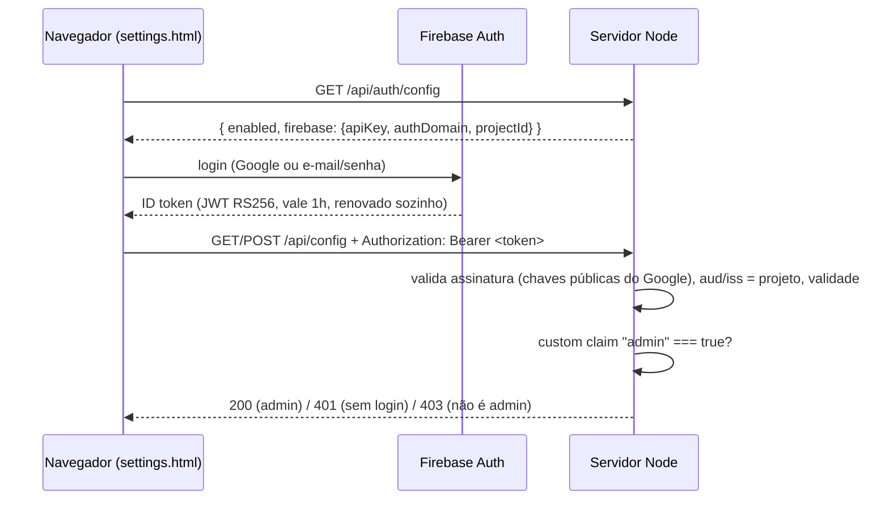

# Login de admin da tela de configuração

A tela de configuração (`/settings.html`) e a API dela (`GET`/`POST
/api/config`) exigem login de **admin**. O login usa o mesmo **Firebase
Authentication** do site institucional (`rizzatotech-site`): mesmas contas,
mesmo login com Google.

Última atualização: 13/10/2026.

---

## 1. Por que existe

Em 05/10/2026 descobrimos que `https://rizzato-tech.rizzatotech.com/settings.html`
e `/api/config` respondiam a **qualquer pessoa**, sem login. A tela nasceu
como ferramenta de debug local. Em produção, isso deixava qualquer um mudar o
comportamento do bot (palavras de handoff, tom, temperatura, capacidades) ou
desligar a notificação de handoff. Nenhum segredo vazava: tokens e chaves
ficam no Key Vault e nunca passam por essa API.

### Status em produção desde 12/10/2026: login real, sem bloqueio no Nginx

O projeto Firebase (`rizzato-tech`) foi criado e configurado (seção 5), o
login foi testado de ponta a ponta pelo domínio público, e o bloqueio
temporário no Nginx (`agente-admin-block.conf`) foi **removido** — a tela
responde normalmente de fora, protegida pelo login de verdade, não mais por
um 404 na borda:

```bash
curl https://rizzato-tech.rizzatotech.com/settings.html       # 200
curl https://rizzato-tech.rizzatotech.com/api/config           # 401 sem token
```

Backup do server block de antes da remoção:
`/etc/nginx/sites-available/rizzato-tech.rizzatotech.com.bak-2026-10-12`.
Se algum dia for preciso reativar o bloqueio (ex.: suspeita de problema no
login), descomentar o `include snippets/agente-admin-block.conf;` naquele
arquivo e `sudo systemctl reload nginx` já resolve — o snippet continua no
disco, só não está mais incluído.

Pra desenvolvimento local sem Firebase nenhum, `CONFIG_AUTH_DISABLED=true`
no `.env` continua funcionando (nunca em produção — o servidor ignora e avisa
no log se `NODE_ENV=production`).

## 2. Como funciona



- O token é verificado **sem o pacote `firebase-admin`**: são cerca de 50
  linhas com o `crypto` nativo (`src/admin/firebaseAuth.ts`). O
  `firebase-admin` traria dezenas de MB de dependências e mais memória
  residente numa VM de 892MB.
- As chaves públicas do Google ficam em cache pelo `max-age` da resposta. Um
  `kid` desconhecido força uma nova busca, porque as chaves rotacionam.
- O SDK do Firebase no navegador é carregado do CDN oficial (`gstatic`), na
  mesma versão do site (12.19.0), e só quando o login está ligado.

## 3. Quem é admin

Um **custom claim** do Firebase (`admin: true`) gravado no próprio usuário —
não mais uma lista de e-mails. Até 13/10/2026 isso era `ADMIN_EMAILS` no
`.env`, comparado contra o e-mail do token (e por isso exigia e-mail
verificado, pra ninguém se auto-promover criando uma conta com e-mail/senha
usando o e-mail do admin). O claim não tem esse risco — só quem tem a
Service Account do Firebase consegue gravá-lo, então `isAdmin()`
(`src/admin/firebaseAuth.ts`) não precisa mais checar `email_verified` pra
decidir isso.

**Promover um admin novo** (da sua máquina, nunca precisa da VM):

```bash
FIREBASE_SERVICE_ACCOUNT_FILE=<caminho-do-json> \
  npx tsx scripts/setAdminClaim.ts <email-da-pessoa>
```

**Revogar:** mesmo comando com `--revoke` no final. Em ambos os casos, a
pessoa só sente o efeito depois de deslogar/logar de novo (ou até 1h, quando
o Firebase renova o token sozinho) — o claim só entra em tokens *novos*.

A Service Account (JSON) se gera em: Firebase Console → Configurações do
projeto → Contas de serviço → Gerar nova chave privada. **Essa, sim, é um
segredo de verdade** (acesso total ao Authentication do projeto) — fica só
na sua máquina, nunca no repositório, nunca na VM (o servidor do bot não
precisa dela pra NADA; só verifica tokens, nunca os escreve).

## 4. Configuração

| Variável (`.env` do agente) | Valor |
|---|---|
| `FIREBASE_PROJECT_ID` | o mesmo `NEXT_PUBLIC_FIREBASE_PROJECT_ID` do site |
| `FIREBASE_API_KEY` | o mesmo `NEXT_PUBLIC_FIREBASE_API_KEY` |
| `FIREBASE_AUTH_DOMAIN` | o mesmo `NEXT_PUBLIC_FIREBASE_AUTH_DOMAIN` (`<projeto>.firebaseapp.com`) |
| `CONFIG_AUTH_DISABLED` | `true` **só em dev local**; nunca na VM (o servidor avisa no log) |

Nenhuma delas é segredo: a config web do Firebase é pública por desenho e
restrita pelos "domínios autorizados". Por isso não vão pro Key Vault. (O
JSON da Service Account da seção 3 é diferente — esse sim é segredo, e nem
aparece aqui porque nunca vai pro `.env` do servidor.)

No **console do Firebase** → Authentication → Settings → **Authorized
domains**, adicione `rizzato-tech.rizzatotech.com`. Sem isso, o popup de
login falha com `auth/unauthorized-domain`. `localhost` já vem autorizado.

**Falha fechada:** sem `FIREBASE_PROJECT_ID`, a API responde 503 e ninguém
entra — e sem ninguém ter o custom claim `admin` (seção 3), todo login válido
ainda recebe 403, nunca acesso. Nunca acontece de "sem config, todo mundo
entra".

## 5. Projeto Firebase (configurado em 11-12/10/2026)

Projeto `rizzato-tech`, criado no console do Firebase, com Authentication →
Google e E-mail/senha ativados. Passos já feitos, pra referência (e pra
repetir se um dia precisar de outro projeto/ambiente):

1. Criar o projeto no console do Firebase e ativar Authentication →
   provedor **Google**.
   **Incidente (13/10/2026):** o provedor **E-mail/senha** foi esquecido
   nessa primeira passada — só o Google foi ativado. Resultado: qualquer
   cadastro por e-mail/senha no site (`rizzatotech-site`) falhava com
   `auth/operation-not-allowed` (HTTP 400), e como esse código não está
   mapeado em `lib/firebase/errors.ts`, aparecia como a mensagem genérica
   "Não foi possível completar a ação" — sem nada no log do lado do bot,
   porque o erro acontece inteiro no navegador, direto contra a API do
   Firebase, antes de qualquer requisição chegar a este servidor. Corrigido
   no mesmo dia, ativando o provedor que faltava.
2. Registrar um app Web e copiar a config (apiKey, authDomain, projectId,
   storageBucket, messagingSenderId, appId).
3. **Site:** os 6 valores foram cadastrados como secrets
   `NEXT_PUBLIC_FIREBASE_*` no GitHub do `rizzatotech-site`, e um rebuild
   (`gh run rerun`) publicou o site já com o Firebase ligado.
4. **Agente:** `FIREBASE_PROJECT_ID`, `FIREBASE_API_KEY` e
   `FIREBASE_AUTH_DOMAIN` no `.env` da VM, seguido de
   `pm2 restart agente-atendimento --update-env`.
5. Authorized domains: `rizzato-tech.rizzatotech.com` e
   `www.rizzatotech.com` adicionados em Authentication → Settings.

**Facebook e Microsoft como provedores de login:** o código já está pronto
dos dois lados (botões em `public/settings.html` e em
`rizzatotech-site/components/auth/AuthForm.tsx`), mas comentados — os
providers nunca foram habilitados no Firebase Console (falta criar um app
em developers.facebook.com e um app registration no Azure AD pra login,
diferente do app registration já usado pela integração de agenda — ver
`docs/AGENDA_INTEGRATION.md`). Pendência conhecida, não uma decisão final.

**Domínio do consentimento do Google:** a tela "Escolher conta para
continuar em..." mostra `rizzato-tech.firebaseapp.com`, não
`www.rizzatotech.com` — decisão deliberada (13/10/2026): trocar isso exigiria
servir a página de auth do Firebase a partir do domínio do site, que hoje é
Azure Static Web Apps, não Firebase Hosting. Ficou como está; revisitar só
se isso se tornar um problema real de confiança do usuário.

## 6. Testes

`tests/firebaseAuth.test.ts` assina tokens com uma chave RSA gerada no teste
e cobre: token válido, outro projeto (`aud`/`iss`), expirado, payload
adulterado, `alg` diferente de RS256 (incluindo `none`), `kid` desconhecido
(nova busca + recusa), token malformado, e as regras de admin — agora o
custom claim `admin` (`true`/`false`/ausente), inclusive o caso que trocou
de comportamento: `admin: true` sem `email_verified` continua autorizando
(seção 3 explica por quê).

Validado contra um servidor local **e em produção** (12/10/2026): login real
pelo navegador, pelo domínio público (`rizzato-tech.rizzatotech.com`), com
`arizzato369@gmail.com` via Google — tela de configuração abriu
normalmente, `/api/config` sem token continua dando 401.
