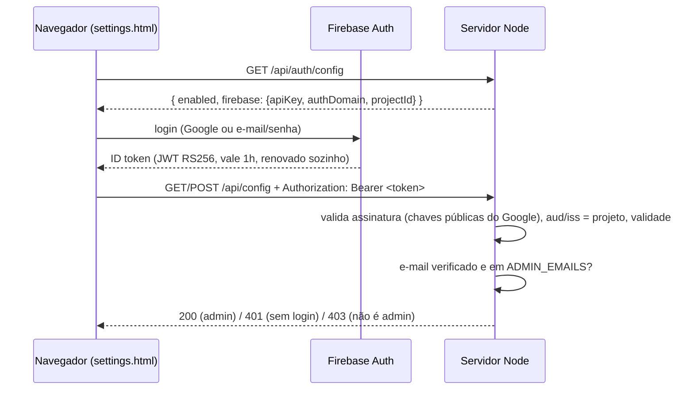

# Login de admin da tela de configuração

A tela de configuração (`/settings.html`) e a API dela (`GET`/`POST
/api/config`) exigem login de **admin**. O login usa o mesmo **Firebase
Authentication** do site institucional (`rizzatotech-site`): mesmas contas,
mesmo login com Google.

Última atualização: 05/10/2026.

---

## 1. Por que existe

Em 05/10/2026 descobrimos que `https://rizzato-tech.rizzatotech.com/settings.html`
e `/api/config` respondiam a **qualquer pessoa**, sem login. A tela nasceu
como ferramenta de debug local. Em produção, isso deixava qualquer um mudar o
comportamento do bot (palavras de handoff, tom, temperatura, capacidades) ou
desligar a notificação de handoff. Nenhum segredo vazava: tokens e chaves
ficam no Key Vault e nunca passam por essa API.

### Medida em vigor hoje: bloqueio no Nginx (opção "rápida", 05/10/2026)

Enquanto o Firebase não está configurado (seção 5), a tela está **fechada
para a internet no Nginx da VM**:

- `/etc/nginx/snippets/agente-admin-block.conf`, incluído no server block de
  `rizzato-tech.rizzatotech.com`, devolve 404 para `/settings.html`,
  `/api/config` e `/api/auth/config`. Backup do arquivo original:
  `/etc/nginx/sites-available/rizzato-tech.rizzatotech.com.bak-2026-10-05`.
- A regex é **case-insensitive**, porque o Express casa rotas sem
  diferenciar maiúsculas (`/API/CONFIG` também chega no handler).
- Verificado: 404 de fora para `/settings.html`, `/SETTINGS.HTML`,
  `/api/config`, `/API/Config`, `/api/config/`, `/api/config?x=1`,
  `/settings%2Ehtml` e `POST /api/config`. Widget, `/health` e
  `/webhook/web/*` continuam 200.
- A porta 3000 do Node está fechada no firewall (NSG) do Azure, então não dá
  pra contornar o Nginx.

**Como acessar a tela agora** (túnel SSH, que fala direto com o Node sem passar
pelo Nginx):

```bash
ssh -L 3000:localhost:3000 azureuser@20.127.12.103
# e no navegador: http://localhost:3000/settings.html
```

**Quando o login de admin for pro ar**, o túnel também passa a pedir login
Firebase. Para manter o acesso só por túnel sem login, defina
`CONFIG_AUTH_DISABLED=true` na VM. Isso é seguro **só enquanto o bloqueio do
Nginx existir**. Para abrir a tela pela internet com login, remova o
`include snippets/agente-admin-block.conf;` e mantenha
`CONFIG_AUTH_DISABLED` vazio.

## 2. Como funciona



- O token é verificado **sem o pacote `firebase-admin`**: são cerca de 50
  linhas com o `crypto` nativo (`src/admin/firebaseAuth.ts`). O
  `firebase-admin` traria dezenas de MB de dependências e mais memória
  residente numa VM de 892MB.
- As chaves públicas do Google ficam em cache pelo `max-age` da resposta. Um
  `kid` desconhecido força uma nova busca, porque as chaves rotacionam.
- O SDK do Firebase no navegador é carregado do CDN oficial (`gstatic`), na
  mesma versão do site (12.19.0), e só quando o login está ligado.

## 3. Quem é admin

`ADMIN_EMAILS` no `.env` do servidor (separados por vírgula), **com e-mail
verificado**. A verificação é obrigatória porque, com login por e-mail/senha,
o Firebase deixa qualquer pessoa criar uma conta com qualquer e-mail
(inclusive o seu); ela só não fica marcada como verificada. **Use "Entrar com
Google"**: o e-mail já vem verificado. A lista só muda editando o `.env` e
reiniciando, nunca pela própria tela.

## 4. Configuração

| Variável (`.env` do agente) | Valor |
|---|---|
| `FIREBASE_PROJECT_ID` | o mesmo `NEXT_PUBLIC_FIREBASE_PROJECT_ID` do site |
| `FIREBASE_API_KEY` | o mesmo `NEXT_PUBLIC_FIREBASE_API_KEY` |
| `FIREBASE_AUTH_DOMAIN` | o mesmo `NEXT_PUBLIC_FIREBASE_AUTH_DOMAIN` (`<projeto>.firebaseapp.com`) |
| `ADMIN_EMAILS` | seu e-mail do Google |
| `CONFIG_AUTH_DISABLED` | `true` **só em dev local**; nunca na VM (o servidor avisa no log) |

Nenhuma delas é segredo: a config web do Firebase é pública por desenho e
restrita pelos "domínios autorizados". Por isso não vão pro Key Vault.

No **console do Firebase** → Authentication → Settings → **Authorized
domains**, adicione `rizzato-tech.rizzatotech.com`. Sem isso, o popup de
login falha com `auth/unauthorized-domain`. `localhost` já vem autorizado.

**Falha fechada:** sem `FIREBASE_PROJECT_ID` e `ADMIN_EMAILS`, a API responde
503 e ninguém entra. Nunca acontece de "sem config, todo mundo entra".

## 5. Estado em 05/10/2026: o Firebase do site ainda não está configurado

O código de login do site existe (commit `c68d4eb`), mas **nenhum projeto
Firebase está ligado a ele**:

- os secrets `NEXT_PUBLIC_FIREBASE_*` não existem no repositório do site
  (`gh secret list` só mostra o token do Azure);
- o build publicado tem `projectId:""`;
- não há `.env.local` local.

Ou seja, hoje o login do site também não funciona em produção. Passos, uma
vez só, servindo pros dois repositórios:

1. Criar (ou escolher) o projeto no console do Firebase e ativar
   Authentication → provedor **Google** (e os outros que o site oferece).
2. Registrar um app Web e copiar a config (apiKey, authDomain, projectId,
   storageBucket, messagingSenderId, appId).
3. **Site:** cadastrar os 6 valores como secrets `NEXT_PUBLIC_FIREBASE_*` no
   GitHub do `rizzatotech-site` e fazer um push (o workflow já os injeta no
   build).
4. **Agente:** `FIREBASE_PROJECT_ID`, `FIREBASE_API_KEY`,
   `FIREBASE_AUTH_DOMAIN` e `ADMIN_EMAILS` no `.env` da VM, depois
   `pm2 restart agente-atendimento --update-env`.
5. Authorized domains: `www.rizzatotech.com` e `rizzato-tech.rizzatotech.com`.

Até o passo 4, a tela de configuração em produção fica **bloqueada** (503).
Para mudar a config nesse meio-tempo, edite o arquivo de `AGENT_CONFIG_PATH`
na VM por SSH e reinicie.

## 6. Testes

`tests/firebaseAuth.test.ts` assina tokens com uma chave RSA gerada no teste
e cobre: token válido, outro projeto (`aud`/`iss`), expirado, payload
adulterado, `alg` diferente de RS256 (incluindo `none`), `kid` desconhecido
(nova busca + recusa), token malformado, e as regras de admin (e-mail
verificado, maiúsculas, fora da lista).

Validado também contra um servidor local: sem token dá 401 em `GET` e
`POST`, um token forjado dá 401 (com busca real das chaves do Google), e
`/api/auth/config` devolve a config. **Não validado ainda:** o login real
pelo navegador, que depende do projeto Firebase da seção 5.
